# STVN 2.0.0 Exploratory Knowledge Graph & Cognitive Dissonance MindMap

- **Canonical SSoT:** `docs/architecture/stvn_knowledge_graph.architecture.stvn`
- **Governing Specifications:** `STVN_LANGUAGE_SPEC.md` (v2.0.0), `STVN-VOP-MANIFESTO.md` (v1.0.0), `STVN_REPOSITORY_SPEC.md` (v2.0.0)
- **Graph Cardinality:** 102 Nodes (`20 DISSONANCE`, `34 SPEC`, `23 GOAL`, `25 HAZARD`) & 82 Directed Causal Edges

---

## 0. Lens 0: Master Ecosystem Topology

```mermaid
%%{init: {'flowchart': {'nodeSpacing': 18, 'rankSpacing': 85, 'curve': 'basis'}}}%%
flowchart LR
    classDef diss fill:#FFEBEE,stroke:#C62828,stroke-width:2px,color:#000000;
    classDef spec fill:#E3F2FD,stroke:#1565C0,stroke-width:2px,color:#000000;
    classDef goal fill:#E8F5E9,stroke:#2E7D32,stroke-width:2px,color:#000000;
    classDef hub  fill:#FFF9C4,stroke:#F57F17,stroke-width:3px,color:#000000;
    classDef haz  fill:#FFF3E0,stroke:#EF6C00,stroke-width:2px,color:#000000;

    %% ========================================================================
    %% TIER 1: COGNITIVE DISSONANCE FRICTION NODES (20 NODES)
    %% ========================================================================
    subgraph Tier1_Dissonance["1. DISSONANCE_* (Developer Intuition Clashes — 20 Nodes)"]
        direction TB
        D1["DISSONANCE_NO_INFIX_COLON_OR_COMMAS\nWhy no 'k: v' or commas? (E030)"]:::diss
        D2["DISSONANCE_HASH_AND_BLOCK_COMMENTS_FORBIDDEN\nWhy no '#' or '/* */' comments? (E001)"]:::diss
        D3["DISSONANCE_STRICT_ZERO_TAB_INVARIANT\nWhy is '\\t' fatal outside fences? (E001)"]:::diss
        D4["DISSONANCE_MANDATORY_FENCED_STRING_TAGS\nWhy no bare '#quot;#quot;#quot;' or '->'? (E025/E026)"]:::diss
        D5["DISSONANCE_POSITIONAL_TUPLES_NO_NAMED_RECORDS\nWhy positional ':Tuple' over JSON keys? (E008)"]:::diss
        D6["DISSONANCE_ORDERED_SETS_AND_MAPS\nWhy are ':Set' & ':Map' order-dependent? (E018)"]:::diss
        D7["DISSONANCE_PARENTHESES_NEVER_FUNCTION_CALLS\nWhy does '#Some(42)' fail? (E008)"]:::diss
        D8["DISSONANCE_NO_COMPOUND_TYPE_KEYWORDS\nWhere did ':Uint16' & ':SeqNonEmpty' go? (E009)"]:::diss
        D9["DISSONANCE_PROHIBITED_MAX_INCL_ON_DISCRETE_TYPES\nWhy no '#maxIncl' on discrete types?"]:::diss
        D10["DISSONANCE_SIZE_PROHIBITED_ON_STRING\nWhy no '#size' on ':String' & 16M cap? (E008)"]:::diss
        D11["DISSONANCE_STRICT_5_TIER_METADATA_ORDERING\nWhy must '#unsigned' precede '#size'? (E003/W003)"]:::diss
        D12["DISSONANCE_FLOAT_NOT_EQUATABLE_BY_DEFAULT\nWhy does ':Set(:Float)' fail? (ERR_TRAIT_VIOLATION)"]:::diss
        D13["DISSONANCE_TOTAL_ABSENCE_OF_NULL\nWhy is there no 'null' keyword? (E008)"]:::diss
        D14["DISSONANCE_ASYMMETRIC_SUM_INFERENCE\nWhy infer '#Right' but never '#Left'? (E023/E024)"]:::diss
        D15["DISSONANCE_OPAQUE_NOMINAL_BRANDS_NO_SUBTYPING\nWhy can't ':UserId' unify with ':AccountId'? (E027)"]:::diss
        D16["DISSONANCE_TRIPARTITE_TEMPORAL_SEGREGATION\nWhy 4 separate temporal models? (E019-E022)"]:::diss
        D17["DISSONANCE_HERMETIC_MODULAR_SPLIT_AND_ZERO_IO_USE\nWhy no ':include' in '.stvn_d' & zero-I/O ':use'? (E035)"]:::diss
        D18["DISSONANCE_EVICTION_CASCADE_AND_BINARY_ZERO_TRUST_GATES\nWhy single-import (E005) & blocked 0x3-0x5?"]:::diss
        D19["DISSONANCE_ASYMMETRIC_META_MANDATE_AND_STEM_BINDING\nWhy is ':meta' optional only in '.stvn'? (E031-E039)"]:::diss
        D20["DISSONANCE_5NF_TYPE_PURITY_VS_WRAPPER_TAX\nWhy not micro-type every internal loop counter?"]:::diss
    end

    %% ========================================================================
    %% TIER 2: NORMATIVE SPECIFICATION MECHANICS (35 NODES)
    %% ========================================================================
    subgraph Tier2_Spec["2. SPEC_* (Normative STVN 2.0.0, VOP & Repository Mechanics — 35 Nodes)"]
        direction TB
        S1["SPEC_DUAL_TRACK_SIGILS_AND_WHITESPACE_DELIMITATION\nPrefix ':' & '#', whitespace siblings (§ 3.1-3.2)"]:::spec
        SB1["SPEC_ROOT_ENCLOSURE_AND_SECTION_SEQUENCE\nRoot '{ ... }' & :meta->:defs->:type->:body (§ 1.1)"]:::spec
        S2["SPEC_C_STYLE_SINGLE_LINE_COMMENTS_ONLY\nExclusive '//' comments (§ 3.4)"]:::spec
        S3["SPEC_ZERO_TAB_LEXICAL_INVARIANT\n2-space ASCII indent; '\\t' only in STR-04 (§ 1.3)"]:::spec
        S4["SPEC_RULE_STR_04_POLYGLOT_FENCED_STRINGS\nMatching '#quot;#quot;#quot;[TAG]...[TAG]#quot;#quot;#quot;' (§ 5.3)"]:::spec
        S5["SPEC_ALGEBRAIC_PRODUCT_TUPLE_CONSTRUCTOR\nPositional ':Tuple(T1..Tn)' (§ 5.4)"]:::spec
        S6["SPEC_INSERTION_ORDERED_COLLECTIONS_AND_SOA_MAPS\nOrdered ':Seq'/':Set'/':Map' & SoA binary (§ 5.5)"]:::spec
        S7["SPEC_STRICT_PRODUCT_DEMARCATION\nBare '#Some 42', '()' strictly ':Tuple' (§ 5.2.1)"]:::spec
        S8["SPEC_ORTHOGONAL_KERNEL_AND_ARBITRARY_BIT_WIDTHS\n6 scalars, 3 colls, n-bit ':Int' in ceil(n/8)B (§ 5.1, App A)"]:::spec
        S9["SPEC_DISCRETE_HALF_OPEN_INTERVAL_GOVERNANCE\nMandatory [minIncl, maxExcl) on discrete types (§ 5.1.2)"]:::spec
        S10["SPEC_LOGICAL_CARDINALITY_VS_PHYSICAL_BIT_WIDTH\n'#minSize'/'#maxSize' (16M cap) vs '#size' (§ 5.1.5)"]:::spec
        S11["SPEC_5_TIER_MONOTONIC_FACET_AND_TAUTOLOGY_GOVERNANCE\nTier 1.1.1->5 order & W003 IR purge (§ 6.1, § 9.2)"]:::spec
        SD1["SPEC_DECOUPLED_CAS_WRITER_VS_PRESENTATION_PRINTERS\nFrozen CanonicalStvnWriter vs Option C printers (§ 3.3.5)"]:::spec
        S12["SPEC_INDUCTIVE_TRAIT_CAPABILITY_CALCULUS\nInductive '#equatable'/'#comparable' & Tier 2 override (§ 6.3)"]:::spec
        SA1["SPEC_VOP_DUAL_INTEGRITY_POSTURES_AND_AXIOMS\nTenet A (Default) & Tenet B (Design) Axioms 1-4 (Manifesto § 1.1-1.3)"]:::spec
        SA2["SPEC_VOP_3NF_PRAGMATIC_EQUILIBRIUM_AND_SPECTRUM\n3NF Smart Constructor sweet spot & 3 Filters (Manifesto § 2.2-3.3)"]:::spec
        S13["SPEC_EXPLICIT_OPTION_COPRODUCT_AND_NULL_MARKED_CODEGEN\nZero-null grammar & explicit ':Option(T)' (§ 5.2, § 7.1.1)"]:::spec
        SB5["SPEC_HOST_CODEGEN_NULL_MARKED_AND_VAR_DIRECTIVES\n'@NullMarked', deep immutability & RHS-typed 'var' (§ 12)"]:::spec
        S14["SPEC_INFERENCE_RULES_A_TO_J_ASYMMETRIC_GUARD\nRules A-C happy path, Rule E forbids '#Left'/'#None' (§ 8.1)"]:::spec
        S15["SPEC_OPAQUE_NOMINAL_BRANDING_AND_TIER1_LOCK\nOpaque FQNI branding & Tier 1 non-overridable lock (§ 9.1)"]:::spec
        SC1["SPEC_ENUM_SUBSET_MONOTONIC_NARROWING_AND_ROOT_ORDER\n'#filterIncl'/'#filterExcl' narrowing & root order (§ 4.8)"]:::spec
        SC2["SPEC_NOMINAL_BOUNDING_OF_RECURSIVE_TYPES_AND_MODULES\nNamed ':defs' disjunctive anchor & acyclic includes (§ 7.1.6)"]:::spec
        S16["SPEC_TRIPARTITE_TEMPORAL_KERNEL_AND_WIRE_LAYOUT\n':TimeEpoch' & ':DateTime' (#offset/#zoned/#audited) (§ 5.6)"]:::spec
        SF2["SPEC_TEMPORAL_ZONE_DICTIONARY_POOL_AND_FIXED_WIRE\nHeader u16 IANA Zone Pool & 8B/10B/12B/14B frames (§ 10.5)"]:::spec
        S17["SPEC_HERMETIC_EXTENSION_MATRIX_AND_TRANSITIVE_FLATTENING\nHermetic vs modular split, zero-I/O ':use' & E029 pruning (§ 1.2, App G)"]:::spec
        SB2["SPEC_ATOMIC_PATH_IDENTIFIERS_AND_PACKAGE_SCOPING\nSlash-delimited FQNIs, ':package' & unary '#strip' (§ 3.6-3.9)"]:::spec
        SB3["SPEC_TYPED_CONSTANT_DEFINITIONS_AND_SUBSTITUTION\nCompile-time '#CONST' validation & substitution (§ 3.8)"]:::spec
        SB4["SPEC_PRELUDE_ISOLATION_AND_RESERVED_NAMESPACES\nExplicit ':org/stvnadore/prelude/*' & E037 lock (§ 3.9, § 11)"]:::spec
        S18["SPEC_EVICTION_CASCADE_AND_BYTE4_ZERO_TRUST_DISPATCH\n5-step eviction cascade & Byte 4 zero-trust gates (§ 4.2, § 10.4)"]:::spec
        S19["SPEC_DOCUMENT_IDENTITY_AND_EXTENSION_KIND_BINDING\nRoot ':meta' rules, 1-2 filename stems & E038 lock (§ 3.10)"]:::spec
        SE1["SPEC_POISONED_SENTINELS_AND_M_EQUALS_N_FAULT_ISOLATION\nPoisoned sentinels, StvnError (M == N) & Rule J (§ 3.5.3, § 7.2)"]:::spec
        SE2["SPEC_BOOTSTRAP_BLAME_PINNING_AND_IDE_CARET_GUARDS\nClause blame pinning & IDE hover/caret boundaries (§ 7.3-7.4)"]:::spec
        SF1["SPEC_BINARY_HEADER_MAGIC_AND_BYTE4_BYTE5_FRAMING\nMagic 0x5354564E, Byte 4 (1:3:4) & Byte 5+ ':meta' (§ 10.1)"]:::spec
        SG1["SPEC_DUAL_TIER_2_64_CAS_STORAGE_AND_RELATIONAL_CATALOG\n2/64 '.stvn_cas.stvn' shards & UNIQUE cas_hash (Repo § 3)"]:::spec
        SG2["SPEC_REPOSITORY_INGRESS_CONFLICT_CALCULUS_STATE_MACHINE\nGates 1-3 & 5-outcome conflict calculus (Repo § 4-5)"]:::spec
        SG3["SPEC_FORENSIC_PROJECTION_SWEEPER_AND_QUARANTINE_ISOLATION\nVirtual-thread sweeper & atomic '.quarantine/' move (Repo § 6)"]:::spec
    end

%% ============================================================================
%% TIER 3: ARCHITECTURAL OBJECTIVES (23 NODES)
%% ============================================================================
    subgraph Tier3_Goals["3. GOAL_* (Architectural Objectives & VOP Targets - 23 Nodes)"]
        direction TB
        G1["GOAL_SINGLE_PASS_LL1_LEXICAL_ISOLATION\nContext-free ':' vs '#' dispatch at char 1 (§ 3.1-3.2)"]:::goal
        G2["GOAL_SIGIL_UNIFORMITY_AND_LINE_LOCAL_LEXING\nReserve '#' strictly for value track & line-local '//' (§ 3.4)"]:::goal
        G3["GOAL_DETERMINISTIC_DIAGNOSTIC_COORDINATE_PINNING\n1:1 byte-offset to visual column alignment (§ 1.3, § 7.3)"]:::goal
        G4["GOAL_HERMETIC_POLYGLOT_AND_CAS_ENVELOPE_ENCAPSULATION\nZero-escape polyglot strings & recursive CAS envelopes (§ 5.3)"]:::goal
        G5["GOAL_ZERO_COPY_POST_ORDER_WIRE_SYMPATHY\nStrategy 0x0 Post-Order DAG without key bloat (§ 10.2)"]:::goal
        G6["GOAL_CANONICAL_VALUE_EQUIVALENCE_AND_SOA_LOCALITY\nCross-runtime byte equivalence & SoA cache locality (§ 5.5)"]:::goal
        G7["GOAL_ISOMORPHIC_DELIMITER_TO_AST_MAPPING\n1:1 correspondence: ()=Tuple, []=Seq/Set, {}=Map (§ 3)"]:::goal
        G8["GOAL_ORTHOGONAL_TYPE_ALGEBRA_AND_BIT_EXACT_CODECS\nDecoupled facets & high-bit zero mask verification (App A)"]:::goal
        G9["GOAL_SEAMLESS_PARTITION_COMPOSITION_AND_UNIQUE_IR\nGapless [a, b) + [b, c) sharding & unique range IR (§ 5.1.2)"]:::goal
        G10["GOAL_BOUNDED_INGRESS_ALLOCATION_SAFETY\n16 MiB perimeter allocation cap vs bit-width (§ 3.3.6, Repo § 5.1)"]:::goal
        G11["GOAL_CROSS_LANGUAGE_CAS_PREIMAGE_CONVERGENCE\nBitwise-identical flattened preimages across runtimes (§ 9.2)"]:::goal
        G12["GOAL_SOUND_EQUIVALENCE_RELATIONS_IN_COLLECTIONS\nReflexive, symmetric, transitive set/map equality (§ 6.3)"]:::goal
        G13["GOAL_MAKE_ILLEGAL_STATES_UNREPRESENTABLE_AND_TOTAL_FUNCTIONS\nVOP North Star: Total immutability & boundary parsing (Manifesto § 1)"]:::goal
        G14["GOAL_HAPPY_PATH_ERGONOMICS_WITH_EXPLICIT_FAILURE_VISIBILITY\nUntagged happy path vs explicit '#Left'/'#None' (§ 8.1)"]:::goal
        G15["GOAL_1_TO_1_CAS_BIJECTIVITY_LAW\nBijection f: NominalSchema <-> SHA-256 CAS Hash (§ 9.2, Repo § 2)"]:::goal
        G16["GOAL_100_PERCENT_ISOMORPHIC_TEMPORAL_ROUND_TRIP_AND_AUDITABILITY\nP(D(E(Parse(t)))) == t & SEC/MiFID/FDA auditability (App E)"]:::goal
        G17["GOAL_AIR_GAPPED_HERMETIC_CAS_IMMUTABILITY\nSelf-contained, zero-I/O schemas & pruned canonical AST (App G)"]:::goal
        G18["GOAL_ORDER_INDEPENDENT_SCOPE_AND_ZERO_TRUST_WIRE_SECURITY\nOrder-independent imports & cryptographic wire auth (§ 4.2, § 10.4)"]:::goal
        G19["GOAL_LOW_CEREMONY_LOCAL_PAYLOADS_WITH_HERMETIC_REGISTRY_IDENTITY\nZero-ceremony local '.stvn' vs strict registry identity (§ 3.10)"]:::goal
        GA["GOAL_PRAGMATIC_MAXIM_WITHOUT_WRAPPER_TAX\nSubstantially difficult to instantiate without GC churn (Manifesto § 2.3)"]:::goal
        GC["GOAL_TYPE_STATE_SUBSET_SAFETY_WITH_ROOT_WIRE_COMPATIBILITY\nLevel 3 Type-State narrowing with root enum wire layout (§ 4.8)"]:::goal
        GE["GOAL_RESILIENT_MONADIC_IDE_FEEDBACK_WITHOUT_CASCADES\nSurgical blame pinning & non-crashing IDE hover (§ 7.2-7.4)"]:::goal
        GG["GOAL_SELF_HEALING_TAMPER_EVIDENT_SCHEMA_REGISTRY\nAutomated catalog recovery & forensic quarantine (Repo § 6)"]:::goal
    end

%% ============================================================================
%% TIER 4: ELIMINATED PRODUCTION HAZARDS (25 NODES)
%% ============================================================================
    subgraph Tier4_Hazards["4. HAZARD_* (Eliminated Distributed Systems & Production Bugs - 25 Nodes)"]
        direction TB
        H1["HAZARD_SYNTACTIC_ROLE_AMBIGUITY\nTrailing-comma failures & key-vs-type lookahead ambiguity"]:::haz
        H2["HAZARD_UNCLOSED_BLOCK_COMMENT_CODE_SWALLOWING\nUnclosed '/*' swallowing constraints & '#' comment confusion"]:::haz
        H3["HAZARD_EDITOR_COLUMN_DRIFT_AND_WHITESPACE_SPOOFING\nTab-width caret drift & INVALID_INNER_AST quarantine"]:::haz
        H4["HAZARD_NESTED_QUOTE_COLLISION_AND_INJECTION\nPremature triple-quote termination & AST token injection"]:::haz
        H5["HAZARD_FIELD_KEY_WIRE_BLOAT_AND_KEY_TYPOS\nRepetitive JSON key wire bloat & silent property typos"]:::haz
        H6["HAZARD_CROSS_RUNTIME_HASH_ITERATION_DRIFT\nNon-deterministic JVM/Rust/Go map iteration corrupting hashes"]:::haz
        H7["HAZARD_ONE_TUPLE_VS_SCALAR_UNBOXING_AMBIGUITY\nAmbiguity between parenthesized scalar & 1-element ':Tuple'"]:::haz
        H8["HAZARD_COMBINATORIAL_KEYWORD_BLOAT_AND_HIGH_BIT_SMUGGLING\nKeyword explosion & covert smuggling in unused upper bits"]:::haz
        H9["HAZARD_OFF_BY_ONE_SHARDING_GAPS_AND_CAS_DUPLICATES\nFencepost time-window gaps & '#maxIncl 9' vs '#maxExcl 10' drift"]:::haz
        H10["HAZARD_UTF8_BYTE_CHAR_CONFUSION_AND_OOM_DOS\nUTF-8 byte-vs-char truncation & unbounded OOM DoS (HTTP 422)"]:::haz
        H11["HAZARD_FACET_PERMUTATION_CAS_HASH_DRIFT\nFacet reordering or redundant defaults changing SHA-256 digests"]:::haz
        H12["HAZARD_IEEE754_NAN_COLLECTION_POISONING\nIEEE-754 NaN != NaN & -0.0/+0.0 poisoning sets and map keys"]:::haz
        H13["HAZARD_NULL_POINTER_EXCEPTION_AND_BILLION_DOLLAR_MISTAKE\nRuntime NPEs & 3-state null/missing/empty ambiguity"]:::haz
        H14["HAZARD_SILENT_ERROR_MASKING_AND_POSITIONAL_SHIFT_CORRUPTION\nSilent error ingestion & missing tokens shifting tuple positions"]:::haz
        H15["HAZARD_CROSS_DOMAIN_ID_SWAPPING_AND_ALIAS_HIJACKING\nSwapping ':UserId'/':AccountId' & 409 AliasConflict hijacking"]:::haz
        H16["HAZARD_TEMPORAL_CONFLATION_AND_DST_CORRUPTION\nDST schedule shifts, tzdb log mutation & spring-forward gaps (E022)"]:::haz
        H17["HAZARD_SUPPLY_CHAIN_INCLUDE_DRIFT_AND_DEAD_CODE_HASH_POLLUTION\nUpstream include drift, hidden I/O & dead-code hash pollution"]:::haz
        H18["HAZARD_IMPORT_ORDER_SHADOWING_AND_MITM_SCHEMA_POISONING\nImport-order shadowing, MITM spoofing & 0x8 disk-write exploits"]:::haz
        H19["HAZARD_ANONYMOUS_SCHEMA_COLLISION_AND_SYSTEM_ENVELOPE_SPOOFING\nAnonymous schema collisions & 'stvn_cas'/'stvn_ir' spoofing (E038)"]:::haz
        HA["HAZARD_DEVELOPER_CIRCUMVENTION_AND_GC_WRAPPER_CHURN\nWrapper-tax GC churn & developer raw-cast escape hatches"]:::haz
        HB["HAZARD_PRELUDE_SPOOFING_AND_UNVALIDATED_CONSTANTS\nShadowing ':org/stvnadore/*' (E037) & overflowing '#CONST' (E009)"]:::haz
        HC["HAZARD_ENUM_ORDINAL_WIRE_DRIFT_AND_INFINITE_TYPE_LOOPS\nSubset ordinal drift (E015), empty enums (E016) & cyclic loops (E007)"]:::haz
        HD["HAZARD_PRINTER_CONFIG_MUTATING_CRYPTOGRAPHIC_CAS_DIGEST\nPretty-printer flags mutating CAS preimages or unverified inference"]:::haz
        HE["HAZARD_PARSER_PANIC_CASCADES_AND_IDE_HOVER_NPE\nWhole-file red-squiggly cascades & IDE hover NPEs on partial ASTs"]:::haz
        HF["HAZARD_SILENT_WIRE_BIT_ROT_AND_UNFRAMED_STREAM_DECODING\nCorrupted wire frames & reserved header bit tampering"]:::haz
        HG["HAZARD_ON_DISK_CAS_BIT_ROT_AND_CATALOG_DESYNC\nDB-vs-CAS desync, 409 schema mutations & tampered CAS blobs"]:::haz
    end

%% ============================================================================
%% TIER 5: CAUSAL EDGE NETWORK (83 DIRECTED EDGES ACROSS TIERS 1-4)
%% ============================================================================

%% --- 5.1 Dissonance Clashes (Tier 1 -> Tier 2) ---
    D1 -->|clashes_with| S1
    D2 -->|clashes_with| S2
    D3 -->|clashes_with| S3
    D4 -->|clashes_with| S4
    D5 -->|clashes_with| S5
    D6 -->|clashes_with| S6
    D7 -->|clashes_with| S7
    D8 -->|clashes_with| S8
    D9 -->|clashes_with| S9
    D10 -->|clashes_with| S10
    D11 -->|clashes_with| S11
    D12 -->|clashes_with| S12
    D13 -->|clashes_with| S13
    D14 -->|clashes_with| S14
    D15 -->|clashes_with| S15
    D16 -->|clashes_with| S16
    D17 -->|clashes_with| S17
    D18 -->|clashes_with| S18
    D19 -->|clashes_with| S19
    D20 -->|clashes_with| SA2

%% --- 5.2 Architectural Justifications & Optimizations (Tier 2 -> Tier 3) ---
    S1 -->|justified_by| G1
    SB1 -->|enforces_boundary| G1
    S2 -->|justified_by| G2
    S3 -->|justified_by| G3
    S4 -->|justified_by| G4
    S5 -->|enables_optimization| G5
    S6 -->|justified_by| G6
    S6 -->|enables_optimization| G6
    S7 -->|justified_by| G7
    S8 -->|justified_by| G8
    S9 -->|justified_by| G9
    S10 -->|justified_by| G10
    S11 -->|justified_by| G11
    SD1 -->|enforces_boundary| G11
    SD1 -->|enforces_boundary| G17
    S12 -->|derives_from| G12
    S13 -->|justified_by| G13
    SA1 -->|justified_by| G13
    SB3 -->|derives_from| G13
    SB5 -->|enforces_boundary| G13
    SC2 -->|enforces_boundary| G13
    SA2 -->|justified_by| GA
    SA2 -->|enables_optimization| G5
    S14 -->|justified_by| G14
    S15 -->|enforces_boundary| G15
    S19 -->|justified_by| G19
    S19 -->|enforces_boundary| G15
    SB4 -->|enforces_boundary| G15
    SG1 -->|enforces_boundary| G15
    SG1 -->|derives_from| G4
    SG2 -->|enforces_boundary| G15
    SG2 -->|derives_from| G11
    S16 -->|justified_by| G16
    SF2 -->|enables_optimization| G16
    S17 -->|enforces_boundary| G17
    S18 -->|enforces_boundary| G18
    SB2 -->|enforces_boundary| G18
    SF1 -->|enables_optimization| G5
    SF1 -->|enforces_boundary| G18
    SC1 -->|justified_by| GC
    SE1 -->|justified_by| GE
    SE2 -->|justified_by| GE
    SE2 -->|derives_from| G3
    SG3 -->|justified_by| GG

%% --- 5.3 Hazard Elimination (Tier 2 / Tier 3 -> Tier 4) ---
    S1 -->|eliminates_hazard| H1
    S2 -->|eliminates_hazard| H2
    S3 -->|eliminates_hazard| H3
    S4 -->|eliminates_hazard| H4
    S5 -->|eliminates_hazard| H5
    S6 -->|eliminates_hazard| H6
    S7 -->|eliminates_hazard| H7
    S8 -->|eliminates_hazard| H8
    S9 -->|eliminates_hazard| H9
    S10 -->|eliminates_hazard| H10
    S11 -->|eliminates_hazard| H11
    SD1 -->|eliminates_hazard| HD
    S12 -->|eliminates_hazard| H12
    S13 -->|eliminates_hazard| H13
    SA2 -->|eliminates_hazard| HA
    S14 -->|eliminates_hazard| H14
    G15 -->|eliminates_hazard| H15
    S16 -->|eliminates_hazard| H16
    SF2 -->|eliminates_hazard| H16
    S17 -->|eliminates_hazard| H17
    S18 -->|eliminates_hazard| H18
    S19 -->|eliminates_hazard| H19
    SB3 -->|eliminates_hazard| HB
    SB4 -->|eliminates_hazard| HB
    SC1 -->|eliminates_hazard| HC
    SC2 -->|eliminates_hazard| HC
    SE1 -->|eliminates_hazard| HE
    SE2 -->|eliminates_hazard| HE
    SF1 -->|eliminates_hazard| HF
    SG2 -->|eliminates_hazard| HG
    SG3 -->|eliminates_hazard| HG
```

## 1. Lens 1: The Skeptic (`#LENS_SKEPTIC`)
*Focus: "Why doesn't STVN behave like JSON, YAML, or Java?" Maps every developer intuition clash (`DISSONANCE_*`) to the concrete STVN 2.0.0 mechanic (`SPEC_*`) that resolves it.*

```mermaid
flowchart LR
    classDef diss fill:#FFEBEE,stroke:#C62828,stroke-width:2px,color:#000000;
    classDef spec fill:#E3F2FD,stroke:#1565C0,stroke-width:2px,color:#000000;

    subgraph Lexical_and_Surface["I. Lexical & Delimiter Friction"]
        D1["DISSONANCE_NO_INFIX_COLON_OR_COMMAS\nWhy no 'k: v' or commas?"]:::diss -->|clashes_with| S1["SPEC_DUAL_TRACK_SIGILS_AND_WHITESPACE_DELIMITATION\nPrefix ':' & '#', whitespace siblings"]:::spec
        D2["DISSONANCE_HASH_AND_BLOCK_COMMENTS_FORBIDDEN\nWhy no '#' or '/* */' comments?"]:::diss -->|clashes_with| S2["SPEC_C_STYLE_SINGLE_LINE_COMMENTS_ONLY\nContiguous '//' only (E001/E030)"]:::spec
        D3["DISSONANCE_STRICT_ZERO_TAB_INVARIANT\nWhy is '\\t' fatal (E001)?"]:::diss -->|clashes_with| S3["SPEC_ZERO_TAB_LEXICAL_INVARIANT\n2-space ASCII indent; tabs only in fenced body"]:::spec
        D4["DISSONANCE_MANDATORY_FENCED_STRING_TAGS\nWhy no bare '#quot;#quot;#quot;' or '->'?"]:::diss -->|clashes_with| S4["SPEC_RULE_STR_04_POLYGLOT_FENCED_STRINGS\nMatching '#quot;#quot;#quot;[TAG]...[TAG]#quot;#quot;#quot;' (E025/E026)"]:::spec
    end

    subgraph Structural_and_Kernel["II. Records, Collections & Kernel Friction"]
        D5["DISSONANCE_POSITIONAL_TUPLES_NO_NAMED_RECORDS\nWhy positional ':Tuple' over JSON keys?"]:::diss -->|clashes_with| S5["SPEC_ALGEBRAIC_PRODUCT_TUPLE_CONSTRUCTOR\n':Tuple(T1..Tn)' with nominal field types"]:::spec
        D6["DISSONANCE_ORDERED_SETS_AND_MAPS\nWhy are ':Set' & ':Map' ordered?"]:::diss -->|clashes_with| S6["SPEC_INSERTION_ORDERED_COLLECTIONS_AND_SOA_MAPS\nMandatory insertion order & '{ [k v] }'"]:::spec
        D7["DISSONANCE_PARENTHESES_NEVER_FUNCTION_CALLS\nWhy does '#Some(42)' fail (E008)?"]:::diss -->|clashes_with| S7["SPEC_STRICT_PRODUCT_DEMARCATION\nBare '#Some 42'; '()' is strictly ':Tuple'"]:::spec
        D8["DISSONANCE_NO_COMPOUND_TYPE_KEYWORDS\nWhere did ':Uint16' & ':SeqNonEmpty' go?"]:::diss -->|clashes_with| S8["SPEC_ORTHOGONAL_KERNEL_AND_ARBITRARY_BIT_WIDTHS\n6 scalars, 3 collections + prefix facets"]:::spec
        D9["DISSONANCE_PROHIBITED_MAX_INCL_ON_DISCRETE_TYPES\nWhy no '#maxIncl' on ':Int'/':DateTime'?"]:::diss -->|clashes_with| S9["SPEC_DISCRETE_HALF_OPEN_INTERVAL_GOVERNANCE\nMandatory [minIncl, maxExcl) on discrete types"]:::spec
        D10["DISSONANCE_SIZE_PROHIBITED_ON_STRING\nWhy no '#size' on ':String' & 16M cap?"]:::diss -->|clashes_with| S10["SPEC_LOGICAL_CARDINALITY_VS_PHYSICAL_BIT_WIDTH\n'#minSize'/'#maxSize' vs '#size' bit-width"]:::spec
        D11["DISSONANCE_STRICT_5_TIER_METADATA_ORDERING\nWhy must '#unsigned' precede '#size'?"]:::diss -->|clashes_with| S11["SPEC_5_TIER_MONOTONIC_FACET_AND_TAUTOLOGY_GOVERNANCE\nStrict 1.1.1 -> 5 order & W003 normalization"]:::spec
        D12["DISSONANCE_FLOAT_NOT_EQUATABLE_BY_DEFAULT\nWhy no ':Set(:Float)' by default?"]:::diss -->|clashes_with| S12["SPEC_INDUCTIVE_TRAIT_CAPABILITY_CALCULUS\nIEEE-754 '#equatable #FALSE' unless overridden"]:::spec
    end

    subgraph VOP_Temporal_and_Modules["III. VOP, Temporal & Module Friction"]
        D13["DISSONANCE_TOTAL_ABSENCE_OF_NULL\nWhy no 'null' keyword?"]:::diss -->|clashes_with| S13["SPEC_EXPLICIT_OPTION_COPRODUCT_AND_NULL_MARKED_CODEGEN\nExplicit ':Option(T)' & '@NullMarked'"]:::spec
        D14["DISSONANCE_ASYMMETRIC_SUM_INFERENCE\nWhy is '#Right' inferred but never '#Left'?"]:::diss -->|clashes_with| S14["SPEC_INFERENCE_RULES_A_TO_J_ASYMMETRIC_GUARD\nRules A-C happy path; Rule E forbids '#Left'/'#None'"]:::spec
        D15["DISSONANCE_OPAQUE_NOMINAL_BRANDS_NO_SUBTYPING\nWhy can't ':UserId' unify with ':AccountId'?"]:::diss -->|clashes_with| S15["SPEC_OPAQUE_NOMINAL_BRANDING_AND_TIER1_LOCK\nOpaque FQNI branding & Tier 1 lock (E027)"]:::spec
        D16["DISSONANCE_TRIPARTITE_TEMPORAL_SEGREGATION\nWhy 4 separate temporal models?"]:::diss -->|clashes_with| S16["SPEC_TRIPARTITE_TEMPORAL_KERNEL_AND_WIRE_LAYOUT\n':TimeEpoch' + ':DateTime' (#offset/#zoned/#audited)"]:::spec
        D17["DISSONANCE_HERMETIC_MODULAR_SPLIT_AND_ZERO_IO_USE\nWhy no ':include' in '.stvn_d' & zero-I/O ':use'?"]:::diss -->|clashes_with| S17["SPEC_HERMETIC_EXTENSION_MATRIX_AND_TRANSITIVE_FLATTENING\nHermetic vs modular split & E029 pruning"]:::spec
        D18["DISSONANCE_EVICTION_CASCADE_AND_BINARY_ZERO_TRUST_GATES\nWhy single-import & blocked 0x3-0x5?"]:::diss -->|clashes_with| S18["SPEC_EVICTION_CASCADE_AND_BYTE4_ZERO_TRUST_DISPATCH\n5-step eviction cascade & Byte 4 zero-trust"]:::spec
        D19["DISSONANCE_ASYMMETRIC_META_MANDATE_AND_STEM_BINDING\nWhy is ':meta' optional only in '.stvn'?"]:::diss -->|clashes_with| S19["SPEC_DOCUMENT_IDENTITY_AND_EXTENSION_KIND_BINDING\nAd-hoc '.stvn' vs mandatory ':meta' & 1-2 stems"]:::spec
        D20["DISSONANCE_5NF_TYPE_PURITY_VS_WRAPPER_TAX\nWhy not micro-type every loop counter?"]:::diss -->|clashes_with| SA["SPEC_VOP_3NF_PRAGMATIC_EQUILIBRIUM_AND_SPECTRUM\n3NF Smart Constructor sweet spot & 3 filters"]:::spec
    end
```



---

## 2. Lens 2: The Data Engineer (`#LENS_DATA_ENGINEER`)
*Focus: Binary wire layouts (SoA, Post-Order DAG, Bit-Exact packing), stream partitioning, and zero silent data corruption.*


---

## 3. Lens 3: Zero-Trust & Regulatory Audit (`#LENS_ZERO_TRUST`)
*Focus: The $1:1$ CAS Bijectivity Law, hermetic boundaries, Byte 4 wire authentication, and self-healing forensic quarantine.*

```mermaid
flowchart TD
    classDef spec fill:#E3F2FD,stroke:#1565C0,stroke-width:2px,color:#000000;
    classDef goal fill:#E8F5E9,stroke:#2E7D32,stroke-width:2px,color:#000000;
    classDef haz fill:#FFF3E0,stroke:#EF6C00,stroke-width:2px,color:#000000;

    S15["SPEC_OPAQUE_NOMINAL_BRANDING_AND_TIER1_LOCK"]:::spec -->|enforces_boundary| G15["GOAL_1_TO_1_CAS_BIJECTIVITY_LAW\nf: NominalSchema <-> SHA-256 CAS Hash"]:::goal
    S19["SPEC_DOCUMENT_IDENTITY_AND_EXTENSION_KIND_BINDING"]:::spec -->|enforces_boundary| G15
    SB4["SPEC_PRELUDE_ISOLATION_AND_RESERVED_NAMESPACES"]:::spec -->|enforces_boundary| G15
    SG1["SPEC_DUAL_TIER_2_64_CAS_STORAGE_AND_RELATIONAL_CATALOG"]:::spec -->|enforces_boundary| G15
    SG2["SPEC_REPOSITORY_INGRESS_CONFLICT_CALCULUS_STATE_MACHINE"]:::spec -->|enforces_boundary| G15
    G15 -->|eliminates_hazard| H15["HAZARD_CROSS_DOMAIN_ID_SWAPPING_AND_ALIAS_HIJACKING\nBlocks 409 AliasConflict & ID Swaps"]:::haz

    S11["SPEC_5_TIER_MONOTONIC_FACET_AND_TAUTOLOGY_GOVERNANCE"]:::spec -->|justified_by| G11["GOAL_CROSS_LANGUAGE_CAS_PREIMAGE_CONVERGENCE"]:::goal
    SD1["SPEC_DECOUPLED_CAS_WRITER_VS_PRESENTATION_PRINTERS"]:::spec -->|enforces_boundary| G11
    SG2 -->|derives_from| G11
    S11 -->|eliminates_hazard| H11["HAZARD_FACET_PERMUTATION_CAS_HASH_DRIFT"]:::haz

    S17["SPEC_HERMETIC_EXTENSION_MATRIX_AND_TRANSITIVE_FLATTENING"]:::spec -->|enforces_boundary| G17["GOAL_AIR_GAPPED_HERMETIC_CAS_IMMUTABILITY"]:::goal
    SD1 -->|enforces_boundary| G17
    S17 -->|eliminates_hazard| H17["HAZARD_SUPPLY_CHAIN_INCLUDE_DRIFT_AND_DEAD_CODE_HASH_POLLUTION"]:::haz

    S18["SPEC_EVICTION_CASCADE_AND_BYTE4_ZERO_TRUST_DISPATCH"]:::spec -->|enforces_boundary| G18["GOAL_ORDER_INDEPENDENT_SCOPE_AND_ZERO_TRUST_WIRE_SECURITY"]:::goal
    SF["SPEC_BINARY_HEADER_MAGIC_AND_BYTE4_BYTE5_FRAMING"]:::spec -->|enforces_boundary| G18
    S18 -->|eliminates_hazard| H18["HAZARD_IMPORT_ORDER_SHADOWING_AND_MITM_SCHEMA_POISONING\nPoisonedRegistryPayloadException on 0x7"]:::haz

    SG3["SPEC_FORENSIC_PROJECTION_SWEEPER_AND_QUARANTINE_ISOLATION"]:::spec -->|justified_by| GG["GOAL_SELF_HEALING_TAMPER_EVIDENT_SCHEMA_REGISTRY"]:::goal
    SG3 -->|eliminates_hazard| HG["HAZARD_ON_DISK_CAS_BIT_ROT_AND_CATALOG_DESYNC\nAtomic Move to .quarantine/"]:::haz
    SG2 -->|eliminates_hazard| HG
```



---

## 4. Lens 4: The VOP Purist (`#LENS_VOP_PURIST`)
*Focus: Making invalid states unrepresentable, total functions, zero-null coproducts, inductive trait calculus, and the 3NF pragmatic equilibrium.*


---

## 5. Lens 5: The Day-1 Practitioner (`#LENS_PRACTITIONER`)
*Focus: Concrete authoring rules, happy-path inference (Rules A–J), non-cascading IDE diagnostics, and blame pinning.*


